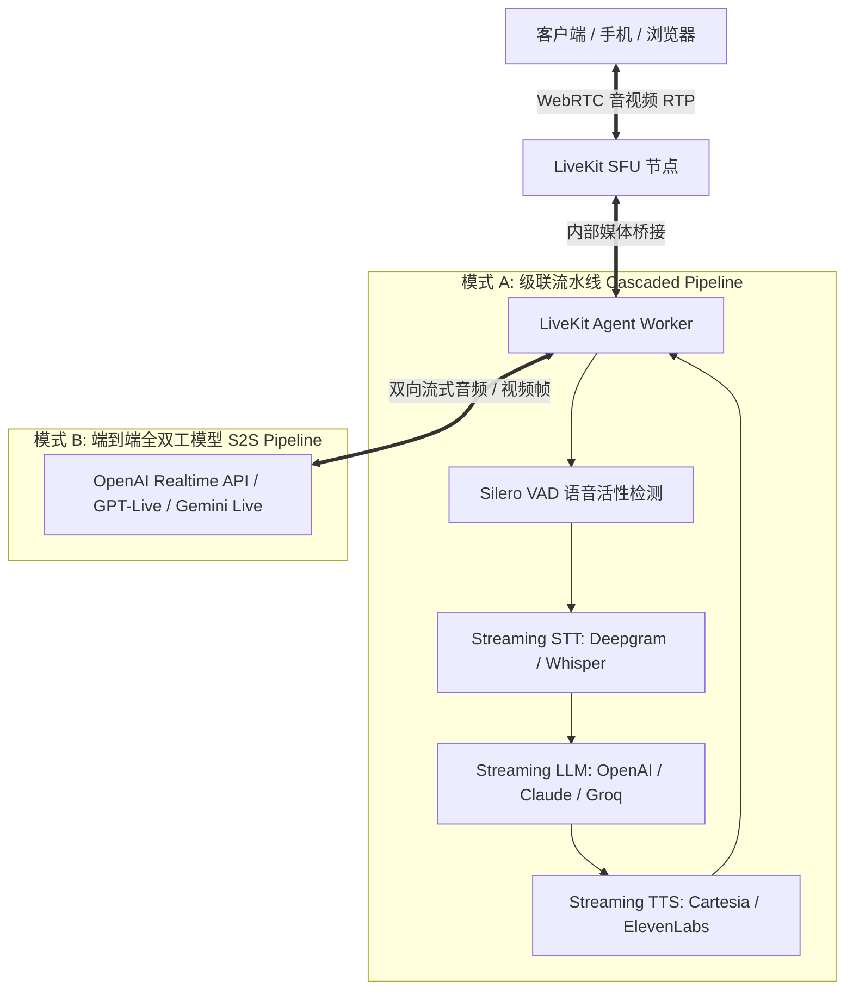

# webrtc
## 1. 代码编译
+ [windows下面编译webrtc](./webrtc_win.md)
+ [ubuntu下面编译webrtc android版本](./webrtc_android.md)
+ [学与思镜像](https://github.com/webrtc-mirror/mirror)
+ [声网镜像](https://webrtc.org.cn/mirror/)

## 2. WebRTC 前端

+ [learning-webrtc](./learning-webrtc)
+ [大前端](https://github.com/feixiao/Web)

## 3. WebRTC 服务器

+ [janus-gateway](./janus-gateway)
+ [medooze](./medooze)

### 3.1 核心维度技术矩阵横向对照（三大体系）
| 维度 | Janus Gateway | SRS (5.0 ~ 7.0) | Pion (以 LiveKit 为代表) | 选型权衡与工业思考 |
| :--- | :--- | :--- | :--- | :--- |
| **实现语言与底层** | C 语言 + Glib 事件循环 + 多线程 | C++ + State-Threads（ST 用户态有栈协程） | 纯 Go 语言（Zero CGO / Goroutine） | Go 语言天然亲和 K8s 微服务生态且无内存越界崩溃；C/C++ 追求极限紧凑转发 |
| **核心架构定位** | 专精于 WebRTC SFU / 多方音视频会议网关 | 统一低延时流媒体服务器，覆盖超低延时直播与轻量 RTC | 现代云原生分布式 SFU（提供极高可扩展性） | 互动会议选 Janus/LiveKit；安防与海量旁路直播分发选 SRS |
| **信令与接口规范** | 自定义 JSON 交互协议（Admin/Gateway API） | 遵循标准 WHIP / WHEP 规范 + 原生 HTTP Webhooks | 自定义 Protobuf + WebSocket + gRPC 内部中继 | SRS 与 LiveKit 标准化程度高，解耦业务信令与媒体 |
| **跨协议互通能力** | 纯 WebRTC（若需 RTMP/FLV 外发需挂载插件） | 原生内存级双向互通：WebRTC ↔ RTMP / SRT / FLV / GB28181 | 纯 WebRTC（需外挂独立 Egress 进程录制转码） | 大型会议若需万人旁路围观或安防联动，SRS 原生转换无需外挂进程 |
| **弱网 QoS 机制** | NACK、PLI/FIR、TWCC/GCC，插件可扩展 | NACK、PLI、TWCC，7.0 引入 RTC Audio Jitter Buffer | NACK、TWCC、RTX (RFC 4588)、Pacer 拦截器链 | LiveKit 与 SRS 均具备完整的单端口 QoS 闭环，LiveKit 支持独立 RTX 重传 |
| **大规模集群方案** | 依靠外部信令做会议级分流，跨机级联极弱 | 原生 Origin-Edge 树状回源；7.0 演进为无状态 Proxy 集群 | 同构无状态 Pod + Redis 调度 + 信令网桥透明代理 | LiveKit 云原生编排最优雅；SRS 吞吐极高；Janus 集群能力最弱 |
| **单端口 UDP 支持** | 默认动态端口段（20000~40000），可挂载插件 | 原生支持单端口 UDP 8000（RFC 7983 分流） | 原生支持单端口（ICEUDPMux 模式） | 单端口彻底根治云原生容器网络 HostPort 耗尽与防火墙打洞痛点 |

### 3.2 选型决策树与场景映射准则
- **Pion / LiveKit 胜出的领域**：现代企业级多方互动音视频会议、AI 实时语音 Agent（OpenAI 推荐底座）、追求全栈 Go 微服务云原生免 CGO 编译的场景；
- **SRS 胜出的领域**：万人旁路超低延时直播（WHEP < 1s）、跨协议内存级转码（FLV/HLS/RTMP）、安防监控国标（GB28181/RTSP）超低时延入会联动；
- **Janus 依然保有的特种护城河**：开箱即用的会议房间状态机（VideoRoom）、服务端音频实时混流降带宽（AudioBridge）、电信级传统 SIP / PSTN 电话交换网打通。

### 3.3 集群演进真相：为什么所有开源自建方案都坚守“同房间单机强收拢”？
在流媒体架构设计中，许多初学者经常幻想“把一个房间分散到多台机器跨机转推”。但深入剖析开源界事实会发现：无论是我们的自研系统、开源 LiveKit，还是新版 SRS，在开源自建场景下全部坚守『同房间单机强收拢（Room Affinity）』：

- **LiveKit 开源官方文档明确限制**：  
  > "In a multi-node setup, LiveKit can support a large number of concurrent rooms. However, there are limits to the number of participants in a room since, for now, a room must fit on a single node."（单房间必须全部容纳在单节点内！开源版不做单房间跨机转推）；
- **SRS 放弃 QUIC 级联（Issue #2091）**：  
  社区曾探索在 Origin 节点间通过 QUIC 级联转发，但最终因为跨机重传延迟累加与协程冲突，官方正式放弃，转而在 7.0 采用 Proxy 代理集群（将同流代理到同一个 K8s Origin Pod）；
- **物理账本约束**：  
  多节点流转不仅增加 15~35ms 骨干网跳数延迟，更致命的是网络抖动累加导致接收端 JitterBuffer 水位被迫拉大 20~50ms，瞬间击穿 200ms 的实时互动 SLA，且机房带宽呈 $N^2$ 爆炸。因此在互动会议中，“同房间单机强收拢”是唯一符合工程 ROI 的最优解。

### 3.4 LiveKit AI Agent 实时语音与多模态架构解析

#### 1. 为什么 AI 实时语音/多模态首选 LiveKit？
- **传统 HTTP/WebSocket 的局限**：全双工但不具备 UDP 弱网 QoS（无 NACK、FEC、JitterBuffer 自适应），高丢包下延迟剧增；TCP 队头阻塞导致音频卡顿；缺乏原生的声学回声消除（AEC）与网络穿透（ICE/STUN/TURN）。
- **LiveKit 的核心优势**：
  - **Worker Pool 调度模型**：将 Agent 建模为房间内的一个特殊 Participant（参与者），LiveKit SFU 原生集成 Job Dispatcher，用户进房时毫秒级拉起或分配空闲的 Agent Worker，天然适配 K8s Pod 扩缩容。
  - **全链路极低延迟**：基于 WebRTC 原生传输，端到端延迟控制在 300ms ~ 800ms 内，满足真人对话的沉浸感（人类对话停顿感知阈值约为 300~500ms）。
  - **OpenAI 官方首选底座**：OpenAI 官方 Realtime API 的 WebRTC 落地范式与参考实现均深度绑定 LiveKit 生态。

#### 2. 核心架构模式（Dual Pipelines）

#### 3. 实时交互的关键工程难题与解决策略
- **毫秒级打断处理（Barge-in / Interruption）**：
  - 用户一旦开口，本地/服务端 VAD 必须在 50~100ms 内检出语音活性；
  - Agent Worker 立即向 LLM/TTS 发送 Cancel 信号截断未完成的生成，并向 WebRTC 发送包清空正在播放的 Playout Buffer，实现“秒停秒应”，杜绝回音干扰与废话重叠。
- **声学回声消除（AEC）与防自激**：
  - AI Agent 自身的输出音频容易被麦克风二次拾取误判为用户打断（Double-talk）。LiveKit 结合 WebRTC 毫秒级时间戳对齐与端侧/网关级 AEC 滤波，精准剥离 Agent 自身伴奏。
- **全双工多模态拓展（Vision & DataChannel）**：
  - **实时视觉理解**：客户端通过 WebRTC 视频轨上行摄像头画面，Agent 按需抽帧送入视觉大模型做实时画面解析；
  - **信令与状态同步**：转写字幕（Transcription）、思考状态（Thinking/Speaking）通过 WebRTC DataChannel 亚毫秒级广播至客户端 UI。
- **电信级电话网打通（SIP Gateway）**：
  - LiveKit 官方提供开箱即用的 SIP Ingress/Egress 组件，可直接接入 Twilio、FreeSWITCH 或电信运营商 PSTN 中继，使得 AI Agent 能直接接听电话或外呼客户。
## 4. SFU 测试工具

