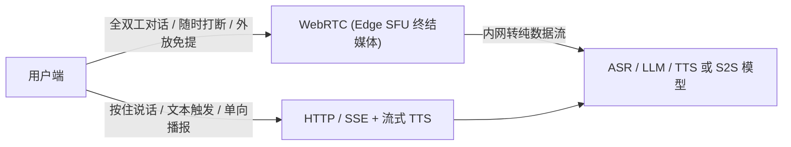

# AI Audio Agent 传输与 TTS 架构选型记录

## 1. 核心结论：二元架构选型

砍掉“双向 WebSocket 传音频”这一中间态（既有长连接/缓冲区/信令复杂度，又无法解决 TCP 队头阻塞与浏览器端 AEC 回声消除缺失），AI Audio Agent 的客户端传输收敛为明确的二元选择：

---

## 2. 什么时候用 WebRTC vs. 直接用 HTTP/SSE + TTS

| 维度 | 路线 A：WebRTC | 路线 B：HTTP / SSE + 流式 TTS |
| :--- | :--- | :--- |
| **核心定位** | **拟人实时通话**（电话 / 陪伴 / 实时客服 / S2S） | **交互式语音回复**（按住说话 / 文本问答 / 有声播报） |
| **底层传输** | UDP (SRTP) + 拥塞控制 (GCC) + Jitter Buffer | TCP + HTTP/2/3 Chunked / SSE |
| **弱网表现** | **丢帧不卡流**，Opus FEC/PLC 抗抖动，端到端延迟稳定 | 依赖缓冲，丢包会触发重传停顿，适合允许 300ms–1s 缓冲的场景 |
| **回声消除 (AEC)** | **强**：浏览器/OS 将 `PeerConnection` 播放轨道直接喂给本地 AEC 参考回路 | 无需（半双工不并发收放，不会自我打断） |
| **打断 (Barge-in)** | 毫秒级抢话打断、静音轨道 / DataChannel 抢占 | 无或较慢（需发新请求取消旧流） |
| **音质取向** | 实时优先：动态降码率、抗丢包牺牲部分音质 | 高保真：不丢字、音质饱满，支持进度条与重听 |
| **工程代价** | 高：ICE/STUN/TURN、SDP 协商、SFU 媒体网关运维 | **极低**：无状态 L7 API，`fetch` / `<audio>` / MSE 即可闭环 |

### 必须上 WebRTC 的场景
1. **免提外放（手机扬声器、车载、智能屏）**：必须依赖 WebRTC 链路绑定的系统/引擎级 AEC 与降噪（NS），否则 AI 播放的 TTS 会被麦克风拾取并触发自我打断（Self-barge-in）。
2. **强实时交互 & 自然打断（< 500ms 响应）**：蜂窝弱网下避免 TCP 队头阻塞导致旧音频堆积与打断信令延迟。
3. **端到端语音大模型（Speech-to-Speech）**：如 Realtime API / Gemini Live，本身是连续双工音频流输入输出。
4. **边缘就近接入**：通过 LiveKit / Daily / 自建 SFU 在用户侧就近终结 UDP，内网回源至推理集群。

### 不要用 WebRTC，直接上 TTS 的场景
1. **半双工交互（Push-to-Talk / 语音消息）**：明确划分“我在说”和“AI 在说”，无并发收放与抢话需求。
2. **播报类 / 朗读类内容**：有声书、新闻、讲解等要求绝对不丢字、高音质，允许预缓冲。
3. **运行环境受限**：企业严苛防火墙封锁 UDP（迫使 WebRTC 退化为 TURN over TCP/TLS，失去延迟优势）、微信小程序、低功耗 IoT MCU（如 ESP32 跑不动完整 WebRTC 协议栈）。
4. **文本优先、语音辅助的 Chat UI**：用户以阅读文字为主，偶尔语音输入或点击朗读。

*(注：仅在**纯硬件 IoT 端**或 **SFU 到后端模型机房的内网段**，因无浏览器沙箱与外放 Web 兼容坑，才保留裸流连接。)*

---

## 3. 为什么 TTS 通常不在本地完成？

| 方案 | 首包延迟 & 算力消耗 | 体积与环境要求 | 音质与表现力 | 典型问题 |
| :--- | :--- | :--- | :--- | :--- |
| **云端神经 TTS** (主流) | 极低（GPU 并发，流式边算边吐） | 客户端零权重，全平台一致 | 极高：支持情绪、停顿、克隆音色、中英混读 | 依赖网络；有持续推理成本 |
| **端侧轻量神经 TTS** (ONNX / WebGPU / CoreML) | 中高：低端手机/无独显电脑易降频、发热 | 需下发 **数十 MB–数百 MB** 权重 | 中等：复杂语境易露机械感 | Web 首屏加载不可接受；移动端内存/发热压力 |
| **OS 原生 TTS** (`speechSynthesis` / `AVSpeech`) | 极低 | 零下载 | 差：机械朗读腔，无情感/语境控制 | 无法流式按 token 精细对齐；各系统音色割裂 |

### 限制本地 TTS 的 5 个硬约束
1. **端侧算力与首包延迟（TTFB）冲突**：现代拟人 TTS（自回归 LLM / Flow Matching）在端侧 CPU/WASM 推理首字延迟高，且会与本地音频采集、AEC、VAD 抢占资源导致掉帧或爆音。
2. **Web 分发体积与浏览器沙箱**：百兆级权重破坏 Web 首屏留存，iOS Safari 等移动 WebView 内存上限严苛易 OOM。
3. **语义表现力不足**：AI Agent 需要笑声、叹气、中英混读（Code-switching）、多音字消歧，端侧小模型难以胜任。
4. **流水线紧耦合与 S2S 趋势**：云端 LLM token 可通过同机房内网（<1ms RTT）直接流式喂给 TTS；而原生 Speech-to-Speech 模型根本没有独立的“文本→TTS”阶段。
5. **音色版权与热更新**：定制/克隆音色属于核心资产，不能下发权重到客户端；云端可随时灰度升级模型。

### 适合本地 TTS 的例外场景
- **离线 / 强隐私合规**：车载离线语音、医疗/保密内网终端。
- **高频调用的成本敏感型原生应用**：利用本地 NPU/GPU 免费算力降低云端账单。
- **固定/半固定提示音**：设备状态播报或预生成音频缓存（Audio Cache）。
