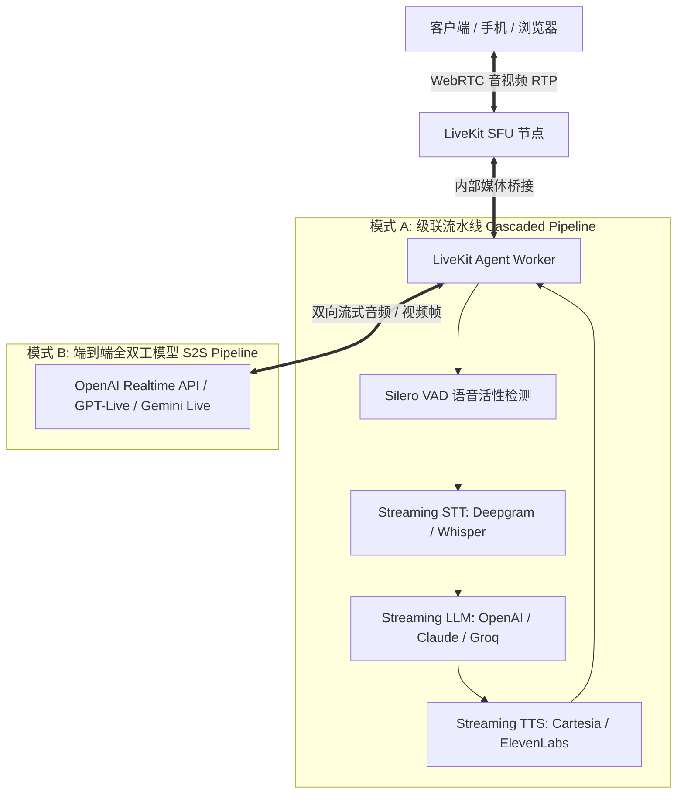

# LiveKit Server 与 Voice Agent 本地部署与测试指南

本目录包含 LiveKit 媒体服务器与全双工 AI Agent 的本地部署方案、配置文件与测试代码，特别适配 Apple Silicon (Mac Studio M4 Max) 与本地大模型（如 LM Studio）。

---

## 1. 目录结构

```
livekit/
├── README.md           # 本地部署与联调测试完整指南
├── livekit_ai_agent.md # LiveKit AI Agent 实时语音与多模态数据流流转架构深度拆解
├── livekit.yaml        # LiveKit Server 本地开发配置文件
├── agent.py            # 支持本地 LM Studio 的全双工语音 Agent 测试脚本
└── requirements.txt    # Python Agent 运行所需依赖
```

---

## 2. LiveKit AI Agent 实时语音与多模态架构解析

### 2.1 为什么 AI 实时语音/多模态首选 LiveKit？
- **传统 HTTP/WebSocket 的局限**：全双工但不具备 UDP 弱网 QoS（无 NACK、FEC、JitterBuffer 自适应），高丢包下延迟剧增；TCP 队头阻塞导致音频卡顿；缺乏原生的声学回声消除（AEC）与网络穿透（ICE/STUN/TURN）。
- **LiveKit 的核心优势**：
  - **Worker Pool 调度模型**：将 Agent 建模为房间内的一个特殊 Participant（参与者），LiveKit SFU 原生集成 Job Dispatcher，用户进房时毫秒级拉起或分配空闲的 Agent Worker，天然适配 K8s Pod 扩缩容。
  - **全链路极低延迟**：基于 WebRTC 原生传输，端到端延迟控制在 300ms ~ 800ms 内，满足真人对话的沉浸感（人类对话停顿感知阈值约为 300~500ms）。
  - **OpenAI 官方首选底座**：OpenAI 官方 Realtime API 的 WebRTC 落地范式与参考实现均深度绑定 LiveKit 生态。

### 2.2 核心架构模式（Dual Pipelines）


### 2.3 实时交互的关键工程难题与解决策略
- **毫秒级打断处理（Barge-in / Interruption）**：
  - 用户一旦开口，本地/服务端 VAD 必须在 50~100ms 内检出语音活性；
  - Agent Worker 立即向 LLM/TTS 发送 Cancel 信号截断未完成的生成，并向 WebRTC 发送包清空正在播放的 Playout Buffer，实现“秒停秒应”，杜绝回音干扰与废话重叠。
- **声学回声消除（AEC）与防自激**：
  - AI Agent 自身的输出音频容易被麦克风二次拾取误判为用户打断（Double-talk）。LiveKit 结合 WebRTC 毫秒级时间戳对齐与端侧/网关级 AEC 滤波，精准剥离 Agent 自身伴奏。
- **全双工多模态拓展（Vision & DataChannel）**：
  - **实时视觉理解**：客户端通过 WebRTC 视频轨上行摄像头画面，Agent 按需抽帧送入视觉大模型做实时画面解析；
  - **信令与状态同步**：转写字幕（Transcription）、思考状态（Thinking/Speaking）通过 WebRTC DataChannel 亚毫秒级广播至客户端 UI。
- **电信级电话网打通（SIP Gateway）**：
  - LiveKit 官方提供开箱即用的 SIP Ingress/Egress 组件，可直接接入 Twilio、FreeSWITCH 或电信运营商 PSTN 中继，使得 AI Agent 能直接接听电话或外呼客户。

> 📖 **进阶深度解析**：关于流数据从麦克风 PCM 到 RTP，在 Agent 内部重采样、分词切片与 20ms 硬件节拍打包回传的底层工程细节，详见 **[LiveKit AI Agent 实时语音流转与处理全链路深度拆解](./livekit_ai_agent.md)**。

---

## 3. 安装并启动 LiveKit Server

### 方式 A：macOS Homebrew 原生安装（推荐）
```bash
# 1. 安装 LiveKit Server 与 CLI 工具
brew install livekit livekit-cli

# 2. 使用当前目录的配置文件启动服务
livekit-server --config ./livekit.yaml
```
> 控制台输出 `HTTP server listening on :7880` 且无报错，即表示 SFU 网关启动成功。

### 方式 B：Docker 容器启动
```bash
docker run --rm -it \
  -p 7880:7880 \
  -p 7881:7881 \
  -p 7882:7882/udp \
  -v $(pwd)/livekit.yaml:/etc/livekit.yaml \
  livekit/livekit-server:latest \
  --config /etc/livekit.yaml
```

* **默认连接凭证**（定义在 `livekit.yaml` 中）：
  - URL: `ws://127.0.0.1:7880`
  - API Key: `devkey`
  - API Secret: `secret`

---

## 4. 启动本地 LM Studio（大模型大脑）

1. 打开 **LM Studio**；
2. 加载适配 Apple Silicon 的模型：
   - 极速推荐：`Qwen/Qwen2.5-14B-Instruct-GGUF`（Q8_0）；
   - 深度思考：`Qwen/Qwen2.5-32B-Instruct-GGUF`（Q8_0 或 Q6_K）；
3. **GPU 显存卸载**：在右侧面板将 `GPU Offload` 拉满（Max）；
4. **关键网络设置（若使用 Docker 必看）**：
   - 切换到左侧 **`Developer`（Local Server）** 面板；
   - **重要**：如果任何组件在 Docker 容器中运行，必须勾选 **`Serve on local network`**（即监听 `0.0.0.0`，允许外部/虚拟网络接入）；
   - 若仅在 Mac 原生宿主机直接运行 Python Agent，则保持默认 `127.0.0.1` 即可；
   - 点击 **Start Server**（默认监听端口 `1234`）；
5. 验证服务是否存活：
   ```bash
   curl http://127.0.0.1:1234/v1/models
   ```
---

## 5. 配置并启动 Agent Worker

### 1. 创建 Python 虚拟环境并安装依赖
```bash
# 进入 livekit 目录
cd livekit

# 创建虚拟环境 (建议 Python 3.10 ~ 3.12)
python3 -m venv .venv
source .venv/bin/activate

# 安装 LiveKit Agents 框架及本地插件
pip install -r requirements.txt
```

### 2. 启动 Agent Worker（开发调试模式）
```bash
# 启动本地 Agent 并连接本机 LiveKit Server
python agent.py dev
```
> 启动成功后，终端会输出：
> `registered worker`，表示已成功注册进 LiveKit SFU 的 Job Dispatcher，正在监听房间呼叫。

---

## 6. 浏览器端实测全双工对话

打开任意支持 WebRTC 的浏览器：

1. 访问官方测试台：👉 **[https://agents-playground.livekit.io/](https://agents-playground.livekit.io/)**
2. 点击右上角的 **`Settings`（设置齿轮）**：
   - **LiveKit Server URL**：填入 `ws://127.0.0.1:7880`
   - **API Key**：填入 `devkey`
   - **API Secret**：填入 `secret`
3. 点击 **`Connect`（连接）**，允许浏览器调用麦克风；
4. **验证效果**：
   - 连接成功后，LiveKit Server 会瞬间将该房间指派给你终端里跑着的 `agent.py`；
   - 耳机中将听到 Agent 的欢迎语，同时网页显示转写字幕与波形动效；
   - 尝试对着麦克风说话，并在 Agent 回答途中**随时插话打断**，测试毫秒级熔断响应。

---

## 7. Docker 跨网络调用宿主机 LM Studio 的陷阱与最佳实践

如果你考虑将 **Agent 也打包放进 Docker 容器**，连接宿主机 Mac 上的 LM Studio 会面临两个致命的网络坑：

```
【常见错误陷阱】
┌────────────────────────────────────────────────────────┐
│  Docker Container (Agent Worker)                       │
│  请求 http://127.0.0.1:1234 ❌ (找的是容器自己，非 Mac)    │
└───────────────────────┬────────────────────────────────┘
                        │ 无法穿透
┌───────────────────────▼────────────────────────────────┐
│  Mac 宿主机 (LM Studio Server)                           │
│  若只监听 127.0.0.1 ❌ (Docker VM 的请求来源 IP 会被拒绝)   │
└────────────────────────────────────────────────────────┘
```

### 陷阱 1：容器内的 `127.0.0.1` 指向容器自身
* 在 Docker 容器内部，`127.0.0.1` 或 `localhost` 是容器的隔离回环接口，根本找不到宿主机 Mac 上运行的程序。
* **解决方案**：在 macOS Docker Desktop 环境下，必须使用专属网关域名：
  ```bash
  # 容器内部连接宿主机 LM Studio 的正确地址：
  http://host.docker.internal:1234/v1
  ```

### 陷阱 2：LM Studio 默认仅监听本地 Loopback
* LM Studio 默认安全策略只绑定宿主机的 `127.0.0.1`。
* 由于 macOS 下 Docker 运行在轻量级 Linux 虚拟机（Hypervisor）中，容器对宿主机的请求会被宿主机视作来自虚拟网卡（如 `192.168.65.x`）的“外部网络请求”直接拒连（Connection Refused）。
* **解决方案**：在 LM Studio 左侧 Local Server 设置中，**必须开启 “Serve on local network” 开关**（绑定到 `0.0.0.0`）。

### 陷阱 3：配置文件 `livekit.yaml` 绑定地址
* 运行在 Docker 里的 LiveKit Server，其配置文件 `livekit.yaml` 中的 `bind_addresses` **必须配置为 `0.0.0.0`**，若写成 `127.0.0.1` 会导致宿主机的 `-p 7880:7880` 端口映射彻底失效。*(当前仓库配置已修复为 `0.0.0.0`)*。

---

## 8. 最佳部署架构推荐（为什么推荐原生运行 Agent？）

| 方案 | 架构说明 | 性能与延迟 | 推荐指数 |
| :--- | :--- | :---: | :---: |
| **方案 A（最佳推荐）** | **LiveKit Server (Docker/Brew) + Agent (Mac 原生 Python) + LM Studio (Mac 原生)** | **极佳 ($<1\text{ms}$ 进程间开销)** | ⭐⭐⭐⭐⭐ |
| **方案 B** | **全部塞进 Docker（Agent 跨桥访问宿主机 LM Studio）** | 较慢（多一层 Docker VM 虚拟网卡转发与地址映射，偶有丢包） | ⭐⭐ |

> **工程建议**：  
> 媒体服务器 LiveKit Server 用 Docker 跑非常方便且干净；但 **Agent Worker 与 LM Studio 强烈建议直接在 Mac 宿主机原生运行**。因为 M4 Max 的核心优势是 128G 统一内存与原生 Metal 硬件直连，原生运行完全没有 Docker 虚拟化网络开销，延迟最低，调试也最为丝滑。

---

## 9. 常见问题与排错自检

### 1. 为什么浏览器显示连接失败？
* 确认 `livekit-server` 正在前台运行，且端口 `7880` 没有被其他进程占用；
* 检查浏览器控制台（F12 Console）是否有 Mixed Content 告警（如从 HTTPS 网站连接本地未加证书的 `ws://` 时，部分浏览器需在地址栏左侧将站点权限的“不安全内容”设为允许）。

### 2. 打断响应慢或延迟大于 1 秒？
* **VAD 门限**：检查 `agent.py` 中的 `min_endpointing_delay`，建议保持在 `0.2`（200ms）；
* **LM Studio 显存卸载**：确认 LM Studio 中 GPU Offload 是否拉满。若误走 CPU 运算，Token 吐出速度会骤降导致卡顿。
