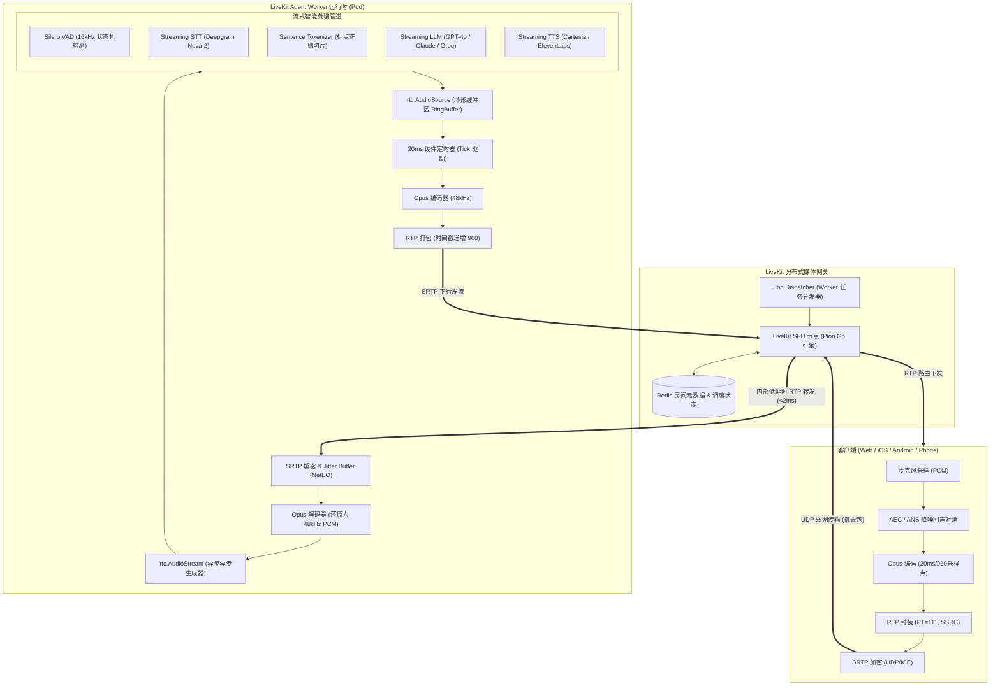
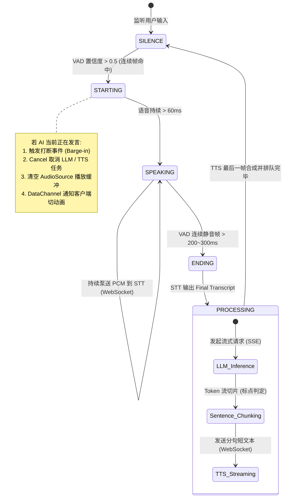
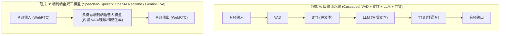
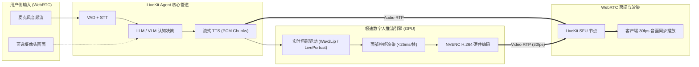

# LiveKit AI Agent 实时语音与多模态数据流流转架构

本文深入拆解在基于 WebRTC 与 LiveKit 的 Voice AI Agent 架构中，**音频/多模态流数据如何从客户端进入 Agent、Agent 内部如何流式处理（VAD / STT / LLM / TTS / S2S）以及最终如何打包装帧回传至客户端播放**的全链路工程实现与底层机制。

---

## 1. 全链路架构总览与数据拓扑

在实时互动系统中，Voice Agent 本质上是作为房间内的一个**具备全双工能力的特殊音视频参会者（Virtual Participant）**。



---

## 2. 阶段一：媒体输入链路（Ingress：从麦克风到 Agent 内存）

### 2.1 客户端声学采集与封装
1. **采样与预处理**：
   - 麦克风录入模拟信号，操作系统声卡转为无损线性 PCM（通常以 48kHz、单声道、16-bit 为工业基准）。
   - 客户端原生 WebRTC 模块执行声学回声消除（AEC3）、背景噪声消除（ANS）与自动增益控制（AGC）。
2. **Opus 压缩与分片**：
   - 将连续 PCM 按照 **20ms** 窗口切片（48,000 采样点/秒 $\times$ 0.02秒 = 每帧 **960** 个音频采样点）。
   - 送入 Opus 编码器进行变码率（VBR）有损压缩，码率通常为 $24 \sim 32\text{ kbps}$，压缩后一帧仅数十至百余字节。
3. **RTP 封装与安全传输**：
   - 压入 RTP 报文头部：Payload Type（如 111 为 Opus）、连续单调递增的 16-bit Sequence Number、递增 960 的 32-bit Timestamp，以及客户端专属的 SSRC。
   - 经由 SRTP（AES-128/256-GCM 或 CTR 模式）加密后，在 UDP 传输层经由 ICE 候选路径发往 LiveKit SFU。

### 2.2 SFU 内部路由
* LiveKit SFU 节点基于纯 Go 语言实现（基于 Pion WebRTC），通过无阻塞 epoll/kqueue 事件驱动转发。
* SFU 不对音频进行解码或混音，仅在内存中执行报文检查，依据房间订阅关系将属于用户的 RTP 数据包直推到 Agent Worker 所在的虚拟连接，内网时延 $< 2\text{ms}$。

### 2.3 Agent Worker 核心接收与还原
Agent 侧内部集成了 LiveKit 的 C++ WebRTC 核心，处理链路如下：
* **NetEQ 抖动缓冲消除**：
  - 处理网络延迟抖动，重排乱序包；
  - 若遇弱网丢包，通过内置的 PLC（Packet Loss Concealment，丢包补偿）算法根据前后帧频谱合成丢失帧，杜绝爆音。
* **解码为标准 PCM**：
  - Opus 解码器将网络包还原为原始标准的 48kHz 单声道 `AudioFrame`。
* **SDK 异步暴露（`rtc.AudioStream`）**：
  - LiveKit Agents SDK 向上层暴露 `rtc.AudioStream(track)` 异步可迭代队列。Python 端通过协程消费音频帧：
  ```python
  audio_stream = rtc.AudioStream(user_track)
  async for frame in audio_stream:
      # frame.data 为连续的 48kHz 16-bit PCM 字节流
      process_frame(frame)
  ```

---

## 3. 阶段二：Agent 内部流式处理引擎（In-Agent Processing）

内部处理是多协程并行的复杂状态机，核心工作流如下：



### 3.1 VAD 语音活性检测与毫秒级打断（Barge-in）
1. **重采样与滑窗**：
   - Silero VAD 模型以 16kHz 为输入标准。
   - Agent 内部模块（`livekit.agents.vad`）将 48kHz 的帧抽取重采样为 16kHz，并以 512 个样本（约 32ms）为一块持续滑窗判决。
2. **状态迁移判定**：
   - **Speech Start**：当连续 2~3 个窗口的语音概率超过阈值（如 0.5），发出 `START_OF_SPEECH`。
   - **Speech End**：当检测到静音并持续超过防抖门限（Silence Hangover，通常配置为 $200 \sim 350\text{ms}$），发出 `END_OF_SPEECH`。
3. **打断处置（Interruption 关键机制）**：
   - 一旦在 Agent 回答期间判定用户开说话，必须在 **50ms 内完成熔断**：
     1. **协程取消**：调用正在生成的 LLM 异步生成器 `generator.aclose()` 及 TTS 任务 `task.cancel()`；
     2. **音频截断**：通知 `rtc.AudioSource` 清空正在排队的环形缓冲（Clear Buffer）；
     3. **信令同步**：通过 WebRTC DataChannel 向客户端发送 `user_interrupted` 事件，客户端立即将本地扬声器中的未播残余数据丢弃。

### 3.2 流式语音识别（Streaming STT）
* PCM 流通过全双工 WebSocket 长连接推送到 STT 引擎（如 Deepgram Nova-2）；
* **双通道事件反馈**：
  - **Interim Transcription（中间临时结果）**：每几十毫秒吐出未定稿文本，用于低延迟展示在客户端 UI（通过 DataChannel 下发）；
  - **Final Transcription（端点稳定结果）**：结合 VAD 的断句点，吐出具备标点和高置信度的最终句子，送入上下文对话历史。

### 3.3 流式 LLM 生成与断句切片器（Sentence Tokenizer）
大模型流式吐出的是碎片化的 Token（如 `["今天", "天气", "非常", "好", "，"]`），不能等全句生成完再送 TTS。
* **分句切片策略（Chunking Strategy）**：
  - **首块急送（Fast-path for First Chunk）**：检测到前 4~8 个词或遇到第一个标点逗号即刻切断发出，**优先抢占第一声发音时间（极度优化 TTFS，压缩至 500ms 左右）**；
  - **后续块自然断句**：根据终结标点（`。`、`！`、`？`、`.`、`!`、`?`、换行）切片，保证 TTS 在合成从句时有正确的升降调与韵律。

### 3.4 流式语音合成（Streaming TTS）
* 文本分片实时推送至极速 TTS 引擎（如 Cartesia Sonic、ElevenLabs Turbo）；
* TTS 引擎同样使用 WebSocket 返回二进制 PCM Chunk（通常为 24kHz/48kHz raw PCM）。

---

## 4. 阶段三：媒体回传与输出链路（Egress：从 Agent 到耳机）

```mermaid
flowchart LR
    subgraph TTSOutput["TTS 服务端"]
        TTSChunk["流式 PCM Chunks (24kHz / 48kHz)"]
    end

    subgraph AudioEngine["Agent 内部音频引擎"]
        Resample["重采样到 48kHz 16-bit 单声道"]
        AudioSource["rtc.AudioSource (RingBuffer 队列)"]
        Timer["20ms 硬件节拍时钟 (960 samples/tick)"]
        OpusEncoder["Opus 实时编码器"]
        RTPPacketizer["RTP 打包器 (生成 SSRC/Seq/Timestamp)"]
    end

    subgraph Network["网络与渲染"]
        SFUDownlink["LiveKit SFU 节点"]
        ClientNetEQ["客户端 JitterBuffer & NetEQ"]
        Speaker["客户端扬声器 / 耳机输出"]
    end

    TTSChunk --> Resample --> AudioSource
    AudioSource --> Timer --> OpusEncoder --> RTPPacketizer
    RTPPacketizer ===> |"SRTP 经 UDP 发送"| SFUDownlink
    SFUDownlink ===> |"下行转发"| ClientNetEQ --> Speaker
```



### 4.1 音频帧入队（`rtc.AudioSource`）
Agent 进程内部创建一个本地音轨并发布到房间：
```python
# 初始化音频输出源 (48kHz, 单声道)
audio_source = rtc.AudioSource(sample_rate=48000, num_channels=1)
track = rtc.LocalAudioTrack.create_audio_track("agent-audio", audio_source)
await room.local_participant.publish_track(track)
```
* 当 TTS 吐出 PCM 块后，调用 `await audio_source.capture_frame(frame)`；
* `AudioSource` 内部包含一个线程安全的音频环形队列（RingBuffer），起到底层平滑缓冲的作用。

### 4.2 20ms 硬件时钟节拍与发包
底层 C++ 媒体线程按严格的 **20ms 硬件定时器循环（Tick）** 运行：
1. **拉取采样**：每次从缓冲队列拉取刚好 20ms（960 个采样点）的 PCM 数据；
2. **静音处理**：若队列为空（AI 处于思考或倾听状态），自动进入非连续传输模式（DTX，Discontinuous Transmission），不产生额外网络流量；
3. **Opus 压缩**：将这 960 个采样压缩为单个 Opus 帧；
4. **生成 RTP 报文**：
   - 赋专属 SSRC；
   - 递增 Sequence Number（如 $1001, 1002, 1003 \dots$）；
   - **时间戳单调递增**：每次增加固定值 $960$（$\Delta\text{Timestamp} = 48000 \times 0.02 = 960$）；
5. 经过 SRTP 加密后送往 UDP Socket。

### 4.3 客户端渲染与双轨同步
1. **音频渲染**：客户端 WebRTC NetEQ 解包播放；
2. **文字同步展示（DataChannel 卡拉 OK 效果）**：
   - 在向 `AudioSource` 推送音频帧的同时，Agent 通过已建立的 WebRTC DataChannel 向客户端广播结构化 JSON：
   ```json
   {
     "event": "transcript",
     "text": "很高兴为您服务",
     "is_final": false,
     "timestamp_ms": 1729000000
   }
   ```
   - 客户端 UI 据此实时渲染逐字跳动或状态光环动效。

---

## 5. 端到端延时预算分解（Latency Budget）

在真人交流中，单向停顿超过 $600\text{ms}$ 即开始让人感受到明显的“机器呆滞迟疑”。工业级 Voice Agent 全链路各阶段耗时控制如下：

| 环节序号 | 链路阶段 | 典型耗时区间 | 核心影响因素与工程优化手段 |
| :---: | :--- | :---: | :--- |
| **①** | **客户端采集上行传输** | $15 \sim 35\text{ ms}$ | WebRTC UDP 裸传，无 TCP 握手重传延迟 |
| **②** | **VAD 句子终点检测（Silence Hangover）** | $150 \sim 250\text{ ms}$ | 判定用户停顿的最短静音窗口（设太短易被打断，设太长延迟高） |
| **③** | **STT 最终转写定稿** | $80 \sim 150\text{ ms}$ | Deepgram Nova-2 流式引擎，WebSocket 保持长连 |
| **④** | **LLM 首 Token 产出（TTFT）** | $150 \sim 300\text{ ms}$ | Groq Llama-3 或 GPT-4o 极速推理，流式 SSE 返回 |
| **⑤** | **断句分词切片** | $< 2\text{ ms}$ | 内存级正向扫描，捕获首句即发 |
| **⑥** | **TTS 首包音频合成** | $80 \sim 150\text{ ms}$ | Cartesia 等现代 WebSocket 流式极速合成 |
| **⑦** | **Agent 下行传输与客户端平滑播放** | $20 \sim 50\text{ ms}$ | Agent 音频直推 SFU，客户端 NetEQ 最小平滑水位 |
| **总计** | **端到端总交互延时（TTFS: 用户停顿到听到第一声）** | **约 $500 \sim 900\text{ ms}$** | **达到流畅真人自然通话的反应速度** |

---

## 6. 两种范式对比：级联流水线 vs 端到端全双工模型



| 维度 | 级联模式（Cascaded Pipeline） | 端到端语音模型（Speech-to-Speech） |
| :--- | :--- | :--- |
| **核心模型** | VAD (Silero) + STT (Deepgram) + LLM (Claude/GPT) + TTS (Cartesia) | OpenAI Realtime API (`gpt-4o-realtime`) / Gemini Live |
| **端到端延时** | $500 \sim 900\text{ ms}$ | **$250 \sim 400\text{ ms}$**（极致逼真） |
| **情感与副语言** | 语调固定，丢失语速变幻、叹气、笑声等情感信息 | **保留语调起伏、犹豫感、情绪、甚至支持哼唱** |
| **工程定制与成本**| **成本极低、模型可任意替换、微调与私有化部署非常成熟** | 调用计费高昂，提示词与输出较难做到确定性约束 |
| **复杂工具调用** | 支持多步 Tool-Calling，断句可控，便于注入私有业务逻辑 | 工具调用机制仍在演进，处理复杂长推理时偶有不稳定 |
| **适用场景** | 传统电话客服、严肃金融办理、任务型流程助理 | 沉浸式口语教练、情感陪伴、高频灵敏交互 Agent |

---

## 7. 典型代码落地参考（基于 LiveKit Agents Python SDK）

```python
import asyncio
from livekit import agents, rtc
from livekit.agents import JobContext, WorkerOptions, cli
from livekit.plugins import deepgram, openai, silero, cartesia

async def entrypoint(ctx: JobContext):
    # 1. 建立与当前房间的连接
    await ctx.connect()
    
    # 2. 初始化核心组件管道
    vad = silero.VAD.load()
    stt = deepgram.STT()
    llm = openai.LLM(model="gpt-4o")
    tts = cartesia.TTS()

    # 3. 构造本地音频源并发布到房间
    audio_source = rtc.AudioSource(sample_rate=48000, num_channels=1)
    track = rtc.LocalAudioTrack.create_audio_track("agent-voice", audio_source)
    await ctx.room.local_participant.publish_track(track)

    # 4. 实例化封装好的语音交互助手 (内置打断、切片与时间戳对齐)
    agent = agents.VoicePipelineAgent(
        vad=vad,
        stt=stt,
        llm=llm,
        tts=tts,
        audio_source=audio_source,
        # 允许用户中途打断
        allow_interruptions=True,
        # 静音阈值 250ms
        min_endpointing_delay=0.25,
    )

    # 5. 启动智能体
    agent.start(ctx.room)
    await agent.say("您好，我是您的 AI 语音助理，请问有什么可以帮您？")

if __name__ == "__main__":
    cli.run_app(WorkerOptions(entrypoint_fnc=entrypoint))
```

---

## 8. 本地私有化落地实操：Mac Studio (M4 Max) + LM Studio 全双工实战

### 8.1 开源性质与本地可行性
* **协议开放**：LiveKit SFU 核心服务与 LiveKit Agents 框架均为 Apache-2.0 协议，完全支持 100% 离线私有化运行。
* **硬件红利**：以 **Mac Studio M4 Max (128GB 统一内存，约 546 GB/s 内存带宽)** 为例，CPU、GPU 与 NPU 零拷贝共享统一显存，足以在单机内同时常驻多方大模型并维持极高吞吐。

### 8.2 延迟预算实测（纯本地 vs 混合模式）
在本地环境下消除了公网传输与握手延迟（本机 Loopback 回环 $<2\text{ms}$）：

| 阶段步骤 | 推荐本地选型 | 实测耗时 (M4 Max) | 说明 |
| :--- | :--- | :---: | :--- |
| **VAD 句子终点检测** | Silero VAD (ONNX) | $150 \sim 200\text{ ms}$ | 判定用户非逗号停顿的最短静音等待（物理必须） |
| **STT 语音转写** | Whisper-Large-v3-Turbo / SenseVoice | $30 \sim 60\text{ ms}$ | 本地并发推理，即说即转 |
| **LLM 首 Token (TTFT)** | Qwen2.5-14B / 32B (LM Studio Metal 加速) | $80 \sim 130\text{ ms}$ | M4 Max 吞吐可达 $45 \sim 80\text{ tokens/s}$ |
| **断句分词切片** | 正则标点分片拦截器 | $< 2\text{ ms}$ | 首句满 4~6 字或命中逗号即刻截断送 TTS |
| **TTS 首包音频合成** | Kokoro-82M / CosyVoice (或云端流式) | $70 \sim 120\text{ ms}$ | 本地输出首个 PCM 块 |
| **端到端总交互延时** | **纯本地/混合闭环 (TTFS)** | **约 $350 \sim 550\text{ ms}$** | **逼近真人日常自然交流的停顿感知（200~300ms）** |

### 8.3 LM Studio 对接代码范例

LM Studio 开启 Local Server（默认 `http://localhost:1234/v1`），GPU Offload 调至最大（全量加载进 128G 显存），Python 代码直接对接：

```python
import asyncio
from livekit import agents, rtc
from livekit.agents import JobContext, WorkerOptions, cli
from livekit.plugins import silero, openai

async def entrypoint(ctx: JobContext):
    await ctx.connect()

    # 1. 本地 VAD 语音断句 (Silero, 纯本地运行)
    vad = silero.VAD.load()

    # 2. 直连本地 LM Studio (流式输出 + 零网络延迟)
    llm = openai.LLM(
        base_url="http://localhost:1234/v1",
        api_key="lm-studio",                  # LM Studio 不需要鉴权，填任意字符串即可
        model="qwen2.5-14b-instruct",         # 对应 LM Studio 当前加载的模型标识
        temperature=0.7,
    )

    # 3. STT / TTS 引擎配置
    # 阶段一推荐混合模式（本地 LLM 保隐私 + 云端极速流式 STT/TTS）体验最丝滑：
    # from livekit.plugins import deepgram, cartesia
    # stt, tts = deepgram.STT(), cartesia.TTS()
    # 阶段二若追求 100% 物理断网纯离线，可切换为本地 whisper.cpp 与 kokoro 服务：
    stt = openai.STT(base_url="http://localhost:8000/v1", api_key="dummy")
    tts = openai.TTS(base_url="http://localhost:8001/v1", api_key="dummy", model="kokoro")

    # 4. 创建全双工 Voice Agent (开启毫秒级打断与短延迟判定)
    agent = agents.VoicePipelineAgent(
        vad=vad,
        stt=stt,
        llm=llm,
        tts=tts,
        allow_interruptions=True,     # 随时插话打断
        min_endpointing_delay=0.2,     # 200ms 静音判定结束
    )

    agent.start(ctx.room)
    await agent.say("你好！我已经在你的 LM Studio 本地大模型上就绪。")

if __name__ == "__main__":
    cli.run_app(WorkerOptions(entrypoint_fnc=entrypoint))
```

---

## 9. 全链路成本核算与降本指南

在基于 WebRTC (LiveKit) 的流式全双工架构中，成本核算通常以 **「单路 Agent 持续通话 1 小时（Agent-Hour）」** 与 **「每分钟有效通话」** 作为评估基准。

### 9.1 通话负载模型假设（1 小时基准）
* **有效发音分布**：用户发音约占 20~25 分钟，AI 回复约占 25~30 分钟，其余 5~10 分钟为静音/思考/网络缓冲。
* **交互轮次**：约 20 ~ 30 轮（Turns）。
* **文本与 Token 量**：
  * STT 语音输入：约 3,000 ~ 5,000 字（词）。
  * LLM 消耗：含历史上下文滑窗（总 Input 约 35k ~ 45k tokens，总 Output 约 5k ~ 8k tokens）。
  * TTS 合成：约 5,000 ~ 8,000 字符。
* **网络流量**：Opus 双向（含 RTP 封装）约 70~80 kbps，1 小时总带宽流量约 30 ~ 36 MB。

### 9.2 三大部署架构成本对比

| 方案分类 | 核心技术栈 | 1 小时通话成本 (USD) | 折合人民币 (元/小时) | 适用场景 |
| :--- | :--- | :---: | :---: | :--- |
| **方案 A：高性价比级联云端栈**<br>*(行业商业化主流)* | • 传输：LiveKit Cloud / 自建 SFU<br>• STT：Deepgram Nova-2<br>• LLM：GPT-4o-mini / DeepSeek-V3<br>• TTS：Cartesia Sonic | **$0.25 ~ $0.45** | **￥1.8 ~ ￥3.2** | 企业级客服、销售外呼、任务型流程助理 |
| **方案 B：旗舰端到端语音模型**<br>*(追求极致情感与副语言)* | • 传输：WebRTC + LiveKit<br>• 模型：OpenAI Realtime API (`gpt-4o-realtime`) | **$6.00 ~ $12.00** | **￥43.0 ~ ￥86.0** | 口语陪练、沉浸式情感陪伴、高客单价场景 |
| **方案 C：私有化/本地自建算力**<br>*(零 API 费，固定算力折旧)* | • 传输：自建 LiveKit SFU<br>• 引擎：Whisper + Qwen2.5 (vLLM/LM Studio) + Kokoro/CosyVoice | **$0.04 ~ $0.10**<br>*(满载并发摊薄)* | **￥0.3 ~ ￥0.7**<br>*(满载并发摊薄)* | 银行/政企内网私有化、数据合规、海量并发 |

### 9.3 方案 A（标准级联流水线）成本拆解（1 小时约 $0.35）
1. **媒体传输（WebRTC / LiveKit）**：
   - LiveKit Cloud 纯音频约为 $0.0005/分钟/端，双向 1 小时约 **$0.06**；自建开源 SFU 单路分摊约 **￥0.02**。
   - 本地 Silero VAD（ONNX）CPU 占用 $<2\%$，**无额外费用**。
2. **流式语音识别（STT）**：
   - Deepgram Nova-2 按有效说话时长计费（约 $0.0059/分钟），20~25 分钟约 **$0.13 ~ $0.15**。
3. **大模型对话（LLM）**：
   - GPT-4o-mini / DeepSeek-V3 1 小时消耗约 **$0.01 ~ $0.02**（若采用旗舰 GPT-4o，则需 $0.25 ~ $0.45）。
4. **流式语音合成（TTS）**：
   - Cartesia Sonic（$0.075 / 10,000 字符），合成 7,000 字符约 **$0.053**。

### 9.4 本地与私有化算力折算（方案 C）
* **终端/边缘单机（如 Mac Studio M4 Max 128G，约 ￥32,000）**：
  - 3 年折旧成本约 ￥1.22/小时，可稳定承载 3~5 路无排队并发流，满载单路每小时折旧约 **￥0.25 ~ ￥0.40**。
* **云端集中 GPU（如 RTX 4090 / NVIDIA L40S）**：
  - 单卡通过 vLLM 批处理配合 FastWhisper 与流式 TTS，稳态可承载 12~18 路并发，单路每小时综合算力分摊约 **￥0.20 ~ ￥0.35**。

### 9.5 工程降本关键实践
1. **VAD 静音门控（Squelch）**：本地 VAD 检测无有效人声时截断向上发送，杜绝空白噪音推送到 STT，减少 **30%~50%** 的无效 STT 账单。
2. **打断即时熔断（Barge-in Truncation）**：用户插话打断时立即取消生成协程并切断 TTS 管道，避免生成废弃音频，节省 **15%~20%** 的 TTS 与 LLM 输出计费。
3. **上下文滑动窗口与摘要**：仅保留最近 3~5 轮完整对话，早期对话做轻量流式摘要，防止 Prompt Tokens 随通话时长膨胀。
4. **分级模型路由（Hierarchical Routing）**：简单意图及状态反馈由轻量小模型直接处理，复杂任务再路由至主大模型。

---

## 10. 多模态视频与数字人（Video AI Agent）优秀案例与架构设计

在实时语音 Agent 跑通后，引入 **视频（Video）多模态流** 可将交互由“听觉交流”升级为具备“眼、脑、耳、口”全要素协同的具身智能。目前在工业界与开源社区中，主要演化出两大核心形态：**视觉理解（Vision-In）** 与 **实时数字人互动（Video-Out）**。

### 10.1 视觉理解类标杆场景（Vision-In：实时画面感知与协同）

Agent 作为“观察者/助手”，实时消费用户的 WebRTC 摄像头流或屏幕共享流，实现“边看、边想、边聊”：

1. **现场故障检修与工业远程 AR 指引（Remote AR Guidance）**：
   * **业务模式**：用户使用手机对准汽车发动机舱、工厂配电柜或受损设备；Agent 实时捕获视频帧并结合语音提示操作（如“请看你右手边红色旋钮，顺时针旋转 90 度”）。
   * **空间交互拓展**：Agent 不仅输出语音，还通过 WebRTC DataChannel 实时回传目标在画面中的归一化坐标 `[ymin, xmin, ymax, xmax]`，客户端 UI 动态绘制高亮方框或 AR 箭头标定物理元器件。
2. **屏幕协同与代码/文档审阅（Screen Share Vision Agent）**：
   * **业务模式**：用户在 WebRTC 房间中开启屏幕共享（IDE 代码、Figma 设计图或财务报表）；当用户提问“这里第 42 行为什么抛出空指针？”时，Agent 自动关联屏幕截帧与上下文代码实时解答。
   * **价值**：免去繁琐的文字复制粘贴与上下文铺垫，实现零阻力的结对协作。
3. **多模态考官与面试/汇报测评（Multimodal Interviewer）**：
   * **业务模式**：不仅转写回答内容，还结合视觉流实时分析候选人的**面部微表情、视线注视点（Gaze Tracking）及体态动作**，面试结束后输出综合能力与心理状态分析报告。

### 10.2 实时数字人互动类（Video-Out：超低延迟音视频双向通话）

将 Agent 输出的 TTS 音频流实时驱动为 30fps 的高保真数字人视频流，使用户获得面对面视频通话的沉浸感：



#### 代表性方案与项目：
* **Simli（商业极速流式数字人 API，仅客户端 SDK 开源）**：
  * **注意**：Simli 的核心面部渲染模型和底层推理服务是**闭源的商业 SaaS/API 服务**（按分钟计费），其 GitHub 开源的只是对接 LiveKit / OpenAI Realtime 的客户端 SDK（如 `simli-client-py`）与 Demo 脚手架。
  * **核心指标**：音频 PCM 到 H.264 首帧画面延迟控制在 **100ms ~ 200ms**，提供原生 WebRTC 双向推拉流能力，支持实时打断。
* **Tavus (Phoenix-2 Conversational Video)**：
  * 闭源商业 API，目前行业内逼真度顶尖的端到端全双工视频对话服务（延迟约 500~800ms），支持精细微表情、头部三维晃动与视线追踪。
* **HeyGen Interactive Avatar**：
  * 闭源商业数字人，支持 4K 高清流下发，主要落地于线下展厅大屏互动与导览机。
* **真正的开源实时自建方案（自研/私有化）**：
  * **Linly-Talker / OpenAvatar**：社区最活跃的开源数字人交互项目，打通了 ASR + LLM + TTS + 实时视频驱动 + WebRTC 链路。
  * **ER-NeRF / RAD-NeRF / GeneFace++**：基于神经辐射场的极速面部驱动模型，单卡 RTX 3090/4090 配合 TensorRT 优化后可实现 $>40\text{ fps}$ 的实时端到端流式渲染。
  * **Wav2Lip / LivePortrait (魔改流式版)**：常用于 2D 照片驱动，需配合 ONNX/TensorRT 做算子融合才能压进 30ms 实时帧预算。
### 10.3 视频 Agent 核心工程挑战与架构解法

| 挑战维度 | 音频 Agent（已实现） | 视频 Agent（引入视觉） | 核心工程落地解法 |
| :--- | :--- | :--- | :--- |
| **数据吞吐量** | Opus 仅需 $24\sim 32\text{ kbps}$ | 1080p@30fps 需 $2 \sim 4\text{ Mbps}$ | Agent 内部无需解码全量 30fps，只在需要时捕获关键帧 |
| **模型推理瓶颈** | STT/LLM 吞吐可达数十 Tokens/s | 多模态大模型单帧推理需 $150 \sim 400\text{ms}$ | **动静解耦抽帧机制**（平时 0.5~1 FPS 保留感知，检测到动作突变/VAD 触发时抓取单张高清帧） |
| **音画同步 (A/V Sync)** | 仅需关注音频时钟（960 samples/tick） | 数字人下发时极易音画不同步 | 利用 RTP Timestamp 单调递增与 RTCP 报文协同，严格对齐 PCM 块与渲染帧 |
| **算力与成本** | 单核 CPU + 本地模型即可跑通 | 视频解码 + 神经渲染需强 GPU（L4 / 4090） | 采用分布式分离架构：LiveKit SFU 管路由，GPU 算力集群跑渲染与推理 |

### 10.4 快速落地技术选型建议
1. **输入端（Vision Agent 边看边聊）**：
   - **接入组件**：使用 LiveKit Python SDK 的 `rtc.VideoStream(track)` 异步拉帧；
   - **模型选型**：公有云优先选择 **Gemini-1.5-Flash**（流式多模态首包延迟短），私有化推荐 **Qwen2-VL-7B (AWQ/4-bit)**；
   - **动态抽帧策略**：日常静止状态降采样至 $0.5\text{ FPS}$ 维持记忆缓冲；VAD 命中用户开口说话瞬间截取高清晰度关键帧作为问答 Prompt 上下文。
2. **输出端（Interactive Avatar 实时数字人）**：
   - **云端商业 API（免运维，体验丝滑）**：首选 **Simli**（低延迟最佳）或 **Tavus**（拟真度最佳）；
   - **纯本地/私有化开源方案**：首选参考 **Linly-Talker** 架构，底层采用 **ER-NeRF** 或 **Wav2Lip + TensorRT** 部署于 GPU 节点；
   - **发布集成**：Agent/渲染服务将生成的 H.264 视频帧作为 `rtc.LocalVideoTrack` 发布至 LiveKit 房间，客户端以标准 `<video>` 标签同步播放音轨与视轨。
